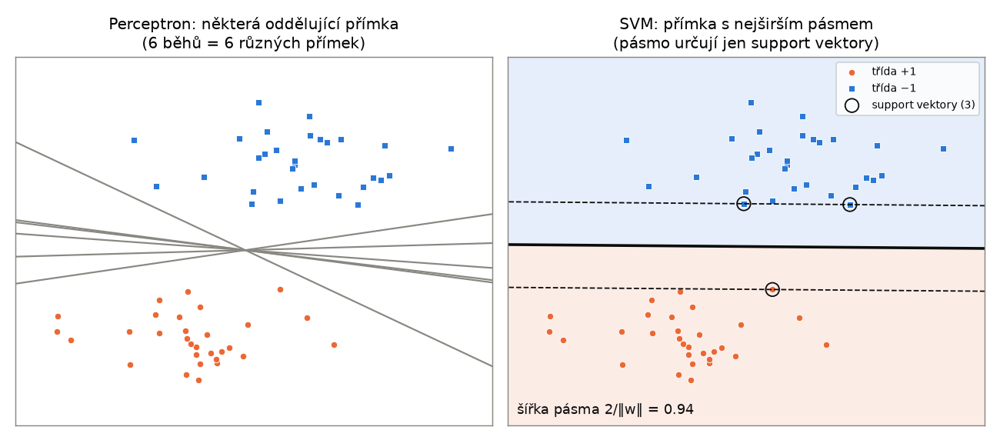
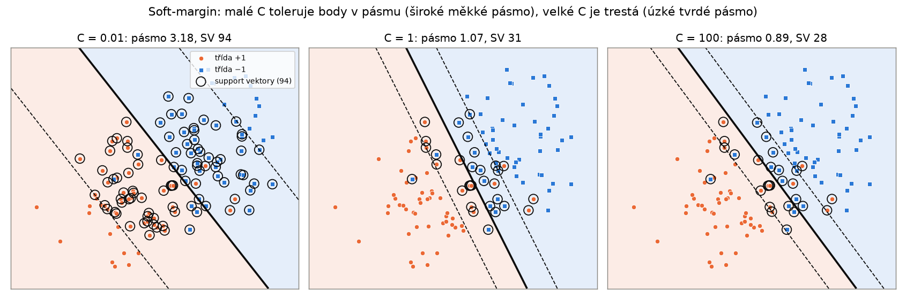
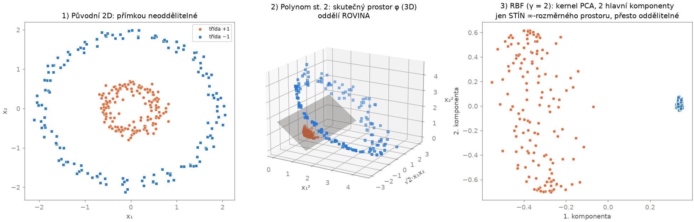
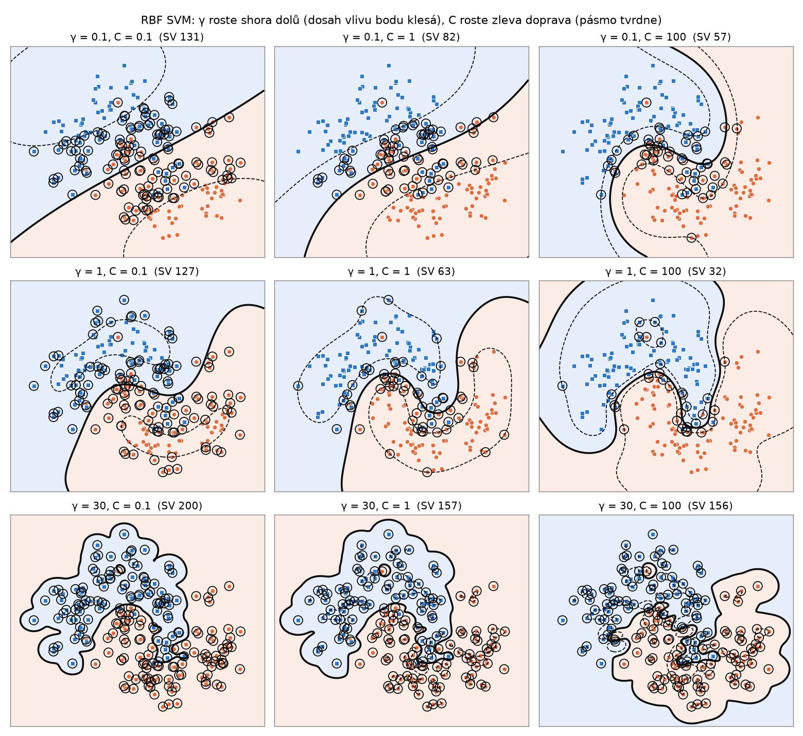
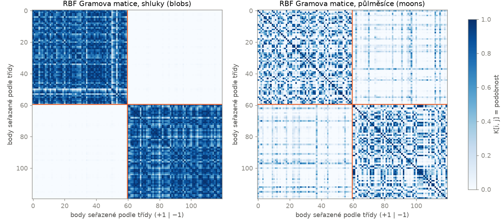
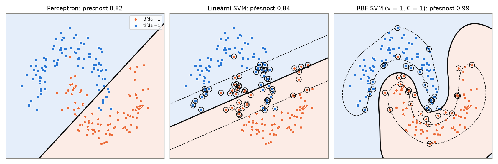

# Cvičení 12: Support Vector Machines a kernelový trik — duál v PyTorch

Dvanácté praktické cvičení předmětu **Umělá inteligence v medicíně** se vrací
ke klasifikaci, tentokrát metodou **Support Vector Machines (SVM)**. V Cvičení
08 jste poznali perceptron, který najde *některou* přímku oddělující dvě
třídy. SVM hledá přímku, kolem níž je **nejširší volné pásmo**. Taková hranice
je stabilnější a lépe zobecňuje na nová data.

Jádrem cvičení je **kernelový trik**. SVM se trénuje v **duální formulaci**,
ve které data vstupují do výpočtu výhradně přes skalární součiny dvojic bodů.
Skalární součin lze nahradit **jádrem** (*kernel*), tedy funkcí podobnosti
dvou bodů. Tím se SVM bez jakékoli změny algoritmu naučí nelineární hranici:
kružnici, půlměsíc nebo obecnou křivku.

Programujete dvě části:

- **Kernelovou knihovnu** (`src/kernels.py`): lineární, polynomiální a RBF
  jádro jako **matice podobností** (Gramovy matice) a tovární funkci, která
  jádro vybere podle jména z `config.yaml`.
- **SVM v duálu** (`src/svm.py`): duální účelovou funkci, krok
  projektovaného gradientního výstupu (gradient počítá *autograd* jako
  v Cvičení 11), rozhodovací funkci, výběr support vektorů, experiment
  s regularizací $C$ a uložení modelu.

Z Cvičení 08 ani 11 se **nekopíruje žádný kód**. Návaznost je koncepční:
perceptron dává pojem oddělující přímky, Cvičení 11 dává PyTorch a autograd.

---

## Obsah

1. [Cíle cvičení](#cíle-cvičení)
2. [Struktura repozitáře](#struktura-repozitáře)
3. [Instalace a spuštění](#instalace-a-spuštění)
4. [Teoretický základ](#teoretický-základ)
5. [Konfigurace projektu](#konfigurace-projektu)
6. [Pokyny k vypracování](#pokyny-k-vypracování)
7. [Lokální testování](#lokální-testování)
8. [Doplňkové (papírové) příklady](#doplňkové-papírové-příklady)
9. [Odevzdání](#odevzdání)

---

## Cíle cvičení

Po dokončení tohoto cvičení student:

1. **Rozumí pojmu pásma (margin).** Umí vysvětlit, čím se hranice SVM liší
   od libovolné hranice perceptronu a proč širší pásmo lépe zobecňuje.
2. **Odvodí úlohu maximálního pásma.** Ví, proč maximalizace šířky pásma
   $2/\lVert\mathbf{w}\rVert$ vede na minimalizaci $\tfrac12\lVert\mathbf{w}\rVert^2$.
3. **Zná duální formulaci.** Umí z Lagrangiánu odvodit $\mathbf{w}=\sum_i\lambda_i y_i\mathbf{x}_i$
   a duální úlohu a vyjmenuje čtyři důvody, proč se SVM řeší v duálu.
4. **Interpretuje regularizaci $C$.** Ví, že $C$ je horní mez boxu
   $0\le\lambda_i\le C$ a jak ovlivňuje šířku pásma, počet support vektorů
   a riziko přeučení.
5. **Implementuje jádra jako matice podobností.** Spočítá Gramovu matici
   lineárního, polynomiálního a RBF jádra bez smyček.
6. **Ověří kernelový trik.** Na polynomu stupně 2 ukáže, že
   $K(\mathbf{a},\mathbf{b})=\varphi(\mathbf{a})\cdot\varphi(\mathbf{b})$,
   a vysvětlí, proč pro RBF jádro zobrazení $\varphi$ vypsat nelze.
7. **Trénuje v duálu.** Napíše krok projektovaného gradientního výstupu
   s gradientem z autogradu a projekcí do boxu.
8. **Pozná support vektory.** Ví, že rozhodovací funkce závisí jen na bodech
   s $\lambda_i>0$, a využije to při vybavování i ukládání modelu.
9. **Vybírá jádro experimentem.** Rozlišuje, co se *implementuje* (jak se
   jádro počítá) a co se *volí* (které jádro a s jakými parametry, podle
   výsledků na datech).
10. **Používá vzor Strategy + Factory a dependency injection.** Jádro je
    zaměnitelná strategie vybíraná řetězcem z konfigurace a do SVM se předává
    hotové.

---

## Struktura repozitáře

```
cviceni-12-template/
├── cviceni_12.py              # Pipeline, celá PŘEDVYPLNĚNA: jen fáze A1–B3 a main()
├── config.yaml                # VŠE nastavitelné: cesty, data, jádra fází, trénink, C, γ, prahy
├── priklady_12.md             # Papírové příklady, BEZ řešení
├── requirements.txt           # Python závislosti (zamčené verze, včetně torch)
├── .gitignore
├── README.md
├── src/
│   ├── __init__.py            # Re-exporty balíčku (neupravujte)
│   ├── kernels.py             # VZOR: LinearKernel; ÚKOL: PolynomialKernel, RBFKernel,
│   │                          #       make_kernel, verify_kernel_trick
│   └── svm.py                 # ÚKOL: dual_objective, _ascent_step, support_vector_indices,
│                              #       decision_function, save, load, sweep_c;
│                              #       smyčka fit, predict, score a logování předvyplněny
├── dataio/
│   ├── __init__.py            # Re-exporty balíčku (neupravujte)
│   ├── loaders.py             # blobs, circles, moons, breast cancer, iris; rozdělení (předvyplněno)
│   ├── config_manager.py      # Dataclassy + load_config + validate_config (předvyplněno)
│   └── plotting.py            # Hranice s pásmem, Gramova matice, průběh duálu, sweep C (předvyplněno)
├── utils/                     # Pomocný kód pipeline (celý PŘEDVYPLNĚNÝ, neupravujte)
│   ├── __init__.py            # Re-exporty balíčku
│   ├── reporting.py           # Hlášky [NENI HOTOVO], [CHYBA ...], [PRESKOCENO], bannery
│   ├── containers.py          # Přepravky výsledků, které si fáze předávají
│   ├── training.py            # Jádro a model z konfigurace, trénink s kontrolou průběhu
│   └── metrics.py             # Kontingenční tabulka, accuracy, precision, Se, Sp, F1 (znáte z cv06)
├── docs/
│   ├── img/                   # Obrázky k teorii v tomto README
│   └── code/gen_figures.py    # Skript, který obrázky v docs/img/ vytvořil (nespouštíte)
├── data/                      # Prázdná: všechna data pocházejí ze sklearn
│   └── .gitkeep
├── graphs/                    # Výstupní grafy (generují se automaticky)
│   └── .gitkeep
├── logs/                      # Log tréninku svm.log (generuje se automaticky)
│   └── .gitkeep
├── models/                    # Uložené modely .pt
│   └── .gitkeep
└── test_cviceni_12.py         # Automatické testy (pytest)
```

> **Poznámka k souborům `__init__.py`:** Každá složka s Python kódem (`src/`,
> `dataio/`, `utils/`) obsahuje `__init__.py`, který ji označuje jako balíček
> a definuje veřejné API. Díky tomu lze psát `from src import KernelSVM` místo
> `from src.svm import KernelSVM`. **Tyto soubory neupravujte.**

> **Žádná brána z minulého cvičení.** Do repozitáře se nevkládá řešení
> z Cvičení 08 ani 11. Perceptron, se kterým se SVM v pipeline srovnává, je
> referenční implementace ze `sklearn`. Všechny hlášky nedokončených částí
> začínají `Úkol:` a týkají se jen tohoto cvičení.

> **Tři balíčky, tři role.** `src/` je **látka cvičení**: jádra a SVM, které
> programujete. `dataio/` přivádí **data a nastavení dovnitř a výsledky ven**
> (načtení, rozdělení, konfigurace, grafy). `utils/` je **orchestrace
> pipeline**: hlášky, přepravky výsledků mezi fázemi, trénink s kontrolou
> průběhu a metriky klasifikace. Závislosti vedou jen jedním směrem, `utils/` používá `src/`
> i `dataio/`, nikdy naopak. Vstupní skript `cviceni_12.py` obsahuje jen
> scénář cvičení: fáze A1–B3 v pořadí, v jakém běží.

---

## Instalace a spuštění

### 1. Vytvoření virtuálního prostředí

```bash
python -m venv .venv
```

Aktivace (Windows):
```bash
.venv\Scripts\activate
```

Aktivace (Linux / macOS):
```bash
source .venv/bin/activate
```

### 2. Instalace závislostí

```bash
pip install -r requirements.txt
```

> **PyTorch je velká závislost.** Instaluje se varianta **pro procesor
> (CPU)**, která má přibližně 200 MB. `requirements.txt` začíná řádkem
> `--extra-index-url`, který na Windows a na Linuxu vybere CPU sestavení místo
> sestavení s podporou CUDA (několik GB). Tento řádek neodstraňujte.
> Grafická karta není potřeba.

### 3. Spuštění

```bash
python cviceni_12.py
```

Pipeline má dvě části a **každá fáze má vlastní ošetření chyb**:

| Fáze | Obsah | Co potřebuje hotové |
|:---|:---|:---|
| A1 | blobs: lineární jádro, Gramova matice, hranice s pásmem, průběh duálu | `make_kernel`; pro trénink `dual_objective`, `_ascent_step`, `support_vector_indices`, `decision_function` |
| A2 | circles: ověření kernelového triku, polynomiální jádro, kontrast s lineárním | `PolynomialKernel`, `verify_kernel_trick`; pro trénink totéž co A1 |
| A3 | moons: perceptron vs. lineární vs. jádrové SVM, mřížka $C$ × $\gamma$ | `RBFKernel` a vše pro trénink |
| B1 | breast cancer: trénink s jádrem z `config.yaml`, kontingenční tabulka, accuracy, precision, Se, Sp, F1 | vše pro trénink |
| B2 | vliv $C$: šířka pásma, počet SV, přesnost | `sweep_c` |
| B3 | uložení modelu do `models/` a kontrolní načtení | úspěšná fáze B1, `save`, `load` |

Dokud nejsou úkoly hotové, fáze, která narazí na nedokončenou část, skončí
hláškou `[NENI HOTOVO] Úkol: …` a pipeline **pokračuje další fází**. Selže-li
již doplněná část (nesplněný assert, nesouhlasící tvary tenzorů), fáze skončí
hláškou `[CHYBA IMPLEMENTACE]` s popisem výjimky. Holý traceback se
nevypisuje. Fáze, která závisí na neúspěšné předchozí fázi, se ohlásí jako
`[PRESKOCENO]` s uvedením důvodu.

Další hlášky:

| Hláška | Význam |
|:---|:---|
| `[CHYBA UCENI]` | duální účelová funkce během tréninku neroste nebo není konečná; krok `training.lr` je příliš velký |
| `[POZOR]` | trénink nedokonvergoval: $L(\lambda)$ za posledních 10 % iterací ještě znatelně rostlo; zvyšte `training.n_iters` |
| `[CHYBA DAT]` | data nelze připravit (nevhodné parametry v sekci `data`) |
| `[CHYBA KONFIGURACE]` | neplatná hodnota v `config.yaml` |

S referenční implementací a výchozí konfigurací trvá celá pipeline na běžném
notebooku přibližně jednu minutu (nejdéle trvají tréninky na breast cancer ve fázích
B1 a B2) a dává tyto výsledky na testovacích datech:

| Fáze | Výsledek |
|:---|:---|
| A1, blobs, lineární jádro | přesnost 1,000; 4 support vektory ze 140 |
| A2, kernelový trik | největší rozdíl $\approx 5\cdot10^{-15}$ |
| A2, circles, polynom $r=2$ / lineární jádro | přesnost 1,000 (13 SV) / 0,567 |
| A3, moons, perceptron / lineární SVM / RBF SVM | přesnost 0,917 / 0,917 / 0,983 |
| B1, breast cancer, RBF $\gamma=0{,}03$, $C=1$ | accuracy 0,965; precision 1,000; Se 0,906; Sp 1,000; F1 0,951 (TP 58, FN 6, TN 107, FP 0); 106 SV ze 398 |

Vaše čísla se mohou v posledních číslicích lišit podle verze knihoven
a procesoru.

---

## Teoretický základ

### 1. Lineární klasifikace a diskriminační nadrovina

Lineární klasifikátor dělí prostor příznaků **nadrovinou** (ve 2D přímkou)

$$g(\mathbf{x}) = \mathbf{w}^\top\mathbf{x} + b = 0 ,$$

kde $\mathbf{w}$ je **normálový vektor** (kolmý na nadrovinu) a $b$ je
**práh** (bias). Bod se zařadí podle znaménka $g(\mathbf{x})$: kladné hodnoty
do třídy $+1$, záporné do třídy $-1$. Třídy v tomto cvičení proto vždy kódujeme
jako $y\in\{-1,+1\}$, nikoli 0/1.

Hodnota $g(\mathbf{x})$ nese i vzdálenost. Orientovaná vzdálenost bodu od
nadroviny je

$$z = \frac{g(\mathbf{x})}{\lVert\mathbf{w}\rVert} .$$

Znaménko určuje stranu nadroviny, absolutní hodnota vzdálenost.

### 2. Perceptron vs. SVM: pásmo

Perceptron z Cvičení 08 se zastaví u **první** přímky, která trénovací data
oddělí. Pro dobře oddělitelná data takových přímek existuje nekonečně mnoho
a perceptron vrátí kteroukoli z nich, podle pořadí bodů a počáteční
inicializace. Přímka vedená těsně kolem některého bodu je citlivá na šum:
nový pacient blízko hranice se snadno ocitne na nesprávné straně.

**SVM vybírá přímku s největším odstupem od obou tříd.** Pás kolem hranice,
ve kterém neleží žádný trénovací bod, se nazývá **pásmo** (*margin*). Body,
které leží přímo na okraji pásma, se nazývají **support vektory**. Hranici
určují jen ony: odebrání kteréhokoli jiného bodu nebo jeho posunutí, při
kterém zůstane mimo pásmo, hranici nezmění.



*Vlevo: šest běhů perceptronu s různým pořadím bodů dá šest různých
oddělujících přímek. Vpravo: SVM najde jedinou přímku s nejširším pásmem
(čárkovaně), určenou třemi support vektory (kroužky).*

> **Most k perceptronu.** Perceptron trestá bod jen tehdy, když leží na
> nesprávné straně: ztráta $\max(0, -y\,g(\mathbf{x}))$. SVM používá
> **hinge ztrátu** $\max(0, 1 - y\,g(\mathbf{x}))$: trestá i správně
> zařazený bod, pokud leží uvnitř pásma, tedy blíže než $y\,g(\mathbf{x})=1$.
> K tomu přidává regularizaci $\lVert\mathbf{w}\rVert^2$, která pásmo
> rozšiřuje. SVM je tedy perceptron, který navíc vyžaduje bezpečnostní
> odstup.

### 3. Odvození úlohy maximálního pásma (primár)

Vektor $\mathbf{w}$ a práh $b$ lze vynásobit libovolnou kladnou konstantou,
aniž se nadrovina $g(\mathbf{x})=0$ změní. Tuto volnost využijeme
k normalizaci: pro body nejbližší hranici (support vektory) požadujeme
$g(\mathbf{x}') = \pm 1$. Jejich vzdálenost od hranice je pak
$1/\lVert\mathbf{w}\rVert$ a **šířka pásma** je

$$\text{šířka} = \frac{2}{\lVert\mathbf{w}\rVert} .$$

Maximalizovat šířku znamená minimalizovat $\lVert\mathbf{w}\rVert$, což je
totéž jako minimalizovat $\tfrac12\lVert\mathbf{w}\rVert^2$ (čtverec odstraní
odmocninu, $\tfrac12$ zjednoduší derivaci). Podmínka, že žádný bod neleží
uvnitř pásma, zní $y_i g(\mathbf{x}_i)\ge 1$. Vzniká **primární úloha**:

$$\min_{\mathbf{w},\,b}\ \frac12\lVert\mathbf{w}\rVert^2 \qquad \text{za podmínek}\qquad y_i(\mathbf{w}^\top\mathbf{x}_i + b)\ \ge\ 1, \quad i = 1,\dots,n .$$

Jde o úlohu **kvadratického programování** (QP): kvadratická účelová funkce
a lineární podmínky. Úloha je **konvexní**, nemá tedy žádná lokální minima
a nalezené řešení je globálně optimální. V tom se SVM liší od neuronových
sítí z Cvičení 10 a 11.

### 4. Duální úloha a proč se používá

Primár je úloha **s podmínkami**: minimalizuje se $\tfrac12\lVert\mathbf{w}\rVert^2$,
ale jen mezi těmi $\mathbf{w}, b$, které splňují $y_i g(\mathbf{x}_i)\ge 1$
pro všechny body. Gradientní metody z předchozích cvičení umějí jen úlohy
bez podmínek. Standardním nástrojem pro převod jsou Lagrangeovy multiplikátory.

> **Lagrangeovy multiplikátory** jsou nástroj pro optimalizaci s podmínkami.
> Každá podmínka dostane vlastní pomocnou proměnnou, **multiplikátor**
> $\lambda$, a podmínky se spolu s multiplikátory přičtou k účelové funkci.
> Vznikne jediná funkce, **Lagrangián** $\mathcal{L}$, jejíž stacionární
> bod (nulové derivace) odpovídá řešení původní úlohy s podmínkami.
>
> **Myšlenka na rovnostní podmínce.** Úloha: minimalizovat $f(x, y) = x^2 + y^2$
> (čtverec vzdálenosti od počátku) za podmínky $x + y = 2$ (bod musí ležet na
> přímce). Bez podmínky je minimum v počátku, ten však na přímce neleží.
> Hledá se tedy bod přímky nejbližší počátku. V takovém bodě se vrstevnice
> funkce $f$ (kružnice kolem počátku) přímky právě **dotýká**, a proto je
> gradient $f$ v tomto bodě rovnoběžný s gradientem podmínky:
> $\nabla f = \lambda\,\nabla(x + y)$ pro nějaké číslo $\lambda$. Kdyby
> rovnoběžný nebyl, šlo by se po přímce posunout směrem, ve kterém $f$ klesá,
> a bod by nebyl optimem. Číslo $\lambda$ je právě multiplikátor. Lagrangián
>
> $$\mathcal{L}(x, y, \lambda) = x^2 + y^2 - \lambda\,(x + y - 2)$$
>
> tuto podmínku rovnoběžnosti zapisuje jako nulové derivace:
>
> $$\frac{\partial\mathcal{L}}{\partial x} = 2x - \lambda = 0,\qquad \frac{\partial\mathcal{L}}{\partial y} = 2y - \lambda = 0,\qquad \frac{\partial\mathcal{L}}{\partial\lambda} = -(x + y - 2) = 0 .$$
>
> První dvě rovnice dávají $x = y = \lambda/2$, třetí vrací původní
> podmínku $x + y = 2$. Řešení je $x = y = 1$, $\lambda = 2$ a minimum
> $f = 2$.
>
> **Co multiplikátor sleduje.** Hodnota $\lambda$ udává, **jak citlivé je
> optimum na podmínku**. Změní-li se podmínka na $x + y = c$, je optimum
> $x = y = c/2$ a $f^* = c^2/2$, takže $\mathrm{d}f^*/\mathrm{d}c = c$. Pro
> $c = 2$ vychází právě $2 = \lambda$. Multiplikátor je tedy „cena“ podmínky:
> o kolik by se zhoršilo (nebo zlepšilo) optimum, kdyby se podmínka nepatrně
> zpřísnila (nebo uvolnila). Velké $\lambda$ znamená, že podmínka optimum
> silně omezuje; $\lambda = 0$ znamená, že na optimum nemá vliv.
>
> **Nerovnostní podmínka, případ SVM.** Úloha: minimalizovat $f(x) = x^2$
> za podmínky $x \ge 1$. Lagrangián je
> $\mathcal{L}(x, \lambda) = x^2 - \lambda\,(x - 1)$ s požadavkem
> $\lambda \ge 0$. U nerovnosti mohou nastat jen dvě situace:
>
> | Situace | Příklad | Optimum | Multiplikátor |
> |:---|:---|:---|:---|
> | podmínka je **aktivní**: optimum leží přesně na její hranici | $x \ge 1$ | $x = 1$ (bez podmínky by bylo $x = 0$) | $\lambda = 2 > 0$ |
> | podmínka je **neaktivní**: optimum ji splňuje s rezervou | $x \ge -1$ | $x = 0$, stejně jako bez podmínky | $\lambda = 0$ |
>
> V prvním případě dává $\partial\mathcal{L}/\partial x = 2x - \lambda = 0$
> v bodě $x = 1$ hodnotu $\lambda = 2$: podmínka optimum posouvá a má
> nenulovou cenu. Ve druhém případě podmínka nic neomezuje a její
> multiplikátor je nulový. Obě situace shrnuje podmínka **komplementarity**
> $\lambda\,(x - 1) = 0$: vždy je nulový buď multiplikátor, nebo rezerva
> v podmínce. V SVM má každý trénovací bod podmínku
> $y_i g(\mathbf{x}_i) \ge 1$ a multiplikátor $\lambda_i$. Bod ležící
> s rezervou mimo pásmo má neaktivní podmínku a $\lambda_i = 0$, bod na
> okraji pásma má aktivní podmínku a $\lambda_i > 0$. **Support vektory jsou
> přesně body s aktivní podmínkou.**
>
> **Duální úloha.** Pro pevné $\lambda$ lze $\mathcal{L}$ minimalizovat
> podle původní proměnné. V příkladu s $x \ge 1$: z $2x - \lambda = 0$ plyne
> $x = \lambda/2$ a po dosazení
>
> $$q(\lambda) = \min_x \mathcal{L}(x, \lambda) = \lambda - \frac{\lambda^2}{4} .$$
>
> Funkce $q(\lambda)$ závisí jen na multiplikátoru. Pro každé $\lambda \ge 0$
> je dolním odhadem optima původní úlohy (zde $q(\lambda) \le 1$) a její
> maximum, dosažené v $\lambda = 2$, je rovno $1 = f(1)$, tedy optimu přesně.
> Místo minimalizace podle $x$ s podmínkou se tak **maximalizuje** funkce
> multiplikátorů s jednoduchou podmínkou $\lambda \ge 0$. Pro konvexní
> úlohy, mezi které SVM patří, je maximum duálu vždy rovno optimu primáru.
> Přesně tento postup se níže provede pro SVM: $\mathcal{L}$ se minimalizuje
> podle $\mathbf{w}$ a $b$, dosadí se zpět a vznikne duální funkce
> $L(\boldsymbol\lambda)$ tvaru „lineární člen minus kvadratický člen“, stejně
> jako $\lambda - \lambda^2/4$ zde.
>
> **Proč je v Lagrangiánu znaménko minus.** Podmínka se zapisuje ve tvaru
> „výraz $\ge 0$“, tedy $x - 1 \ge 0$, resp. $y_i g(\mathbf{x}_i) - 1 \ge 0$.
> Je-li porušena, je výraz záporný a člen $-\lambda\,(\cdot)$ s kladným
> $\lambda$ hodnotu $\mathcal{L}$ zvyšuje, tedy porušení penalizuje. Při
> maximalizaci přes $\lambda \ge 0$ by penalizace rostla neomezeně, a proto
> optimum nikdy neleží v bodě, který podmínku porušuje.

Pro SVM se zavede jeden multiplikátor $\lambda_i\ge 0$ pro každý trénovací
bod, tedy pro každou podmínku $y_i g(\mathbf{x}_i)\ge 1$:

$$\mathcal{L}(\mathbf{w}, b, \boldsymbol\lambda) = \frac12\lVert\mathbf{w}\rVert^2 - \sum_i \lambda_i\big[y_i(\mathbf{w}^\top\mathbf{x}_i + b) - 1\big] .$$

V optimu jsou derivace podle $\mathbf{w}$ a $b$ nulové (stacionarita):

$$\frac{\partial\mathcal{L}}{\partial\mathbf{w}} = 0 \ \Rightarrow\ \mathbf{w} = \sum_i \lambda_i y_i\mathbf{x}_i , \qquad \frac{\partial\mathcal{L}}{\partial b} = 0 \ \Rightarrow\ \sum_i \lambda_i y_i = 0 .$$

První rovnost je klíčová: **vektor $\mathbf{w}$ je lineární kombinací
trénovacích bodů**. Dosazením zpět do $\mathcal{L}$ zmizí $\mathbf{w}$ i $b$
a zůstane **duální úloha**:

$$\max_{\boldsymbol\lambda}\ L(\boldsymbol\lambda) = \sum_i \lambda_i - \frac12\sum_{i,j}\lambda_i\lambda_j\,y_i y_j\,\mathbf{x}_i^\top\mathbf{x}_j \qquad \text{za podmínek}\qquad \sum_i\lambda_i y_i = 0,\quad \lambda_i\ge 0 .$$

Rozhodovací funkce pro nový bod $\mathbf{x}$ vznikne dosazením
$\mathbf{w}=\sum_i\lambda_i y_i\mathbf{x}_i$ do $g(\mathbf{x})$:

$$h(\mathbf{x}) = \sum_{i\in SV}\lambda_i y_i\,\mathbf{x}_i^\top\mathbf{x} + b .$$

Sčítá se jen přes support vektory (SV), protože všechny ostatní body mají
$\lambda_i = 0$.

**Čtyři důvody, proč se SVM řeší v duálu:**

| | Důvod | Vysvětlení |
|:---:|:---|:---|
| a) | **kernelový trik** | data vstupují do duálu i do $h(\mathbf{x})$ jen přes skalární součiny $\mathbf{x}_i^\top\mathbf{x}_j$, které lze nahradit jádrem $K(\mathbf{x}_i,\mathbf{x}_j)$ (odd. 8) |
| b) | **úspornost** | duál má $n$ proměnných (počet bodů), primár $d$ (počet příznaků); při málo vzorcích a mnoha příznacích, typických pro medicínská data, je duál menší |
| c) | **support vektory** | duál je odhalí přímo: jsou to body s $\lambda_i > 0$ |
| d) | **standardní QP** | duál je kvadratický program s jednoduchými podmínkami, pro který existují ověřené řešiče |

> **Význam hodnot $\lambda_i$ (podmínky KKT).** V optimu platí pro každý
> bod jedna ze tří možností: $\lambda_i = 0$, pak $y_i g(\mathbf{x}_i)\ge 1$,
> bod leží mimo pásmo (nanejvýš na jeho okraji) a na hranici nemá vliv;
> $0 < \lambda_i < C$, pak $y_i g(\mathbf{x}_i) = 1$, bod leží přesně na okraji
> pásma; $\lambda_i = C$, pak $y_i g(\mathbf{x}_i)\le 1$, bod leží uvnitř pásma
> nebo na nesprávné straně (soft margin, odd. 5). Body s $\lambda_i > 0$
> tvoří support vektory.

### 5. Soft-margin C-SVM

Reálná data, zvláště medicínská, bývají **neoddělitelná**: třídy se
překrývají a žádná přímka nesplní všechny podmínky $y_i g(\mathbf{x}_i)\ge 1$.
Každý bod proto dostane **volnou proměnnou** $\xi_i\ge 0$ (*slack*), která
měří, o kolik podmínku porušuje:

| $\xi_i$ | Poloha bodu |
|:---|:---|
| $\xi_i = 0$ | mimo pásmo, na správné straně |
| $0 < \xi_i \le 1$ | uvnitř pásma, ale stále na správné straně hranice |
| $\xi_i > 1$ | na nesprávné straně hranice (chybně zařazený) |

Primár se rozšíří o trest za porušení:

$$\min_{\mathbf{w},\,b,\,\boldsymbol\xi}\ \frac12\lVert\mathbf{w}\rVert^2 + C\sum_i\xi_i \qquad\text{za podmínek}\qquad y_i(\mathbf{w}^\top\mathbf{x}_i + b)\ge 1 - \xi_i,\quad \xi_i\ge 0 .$$

**Parametr $C$ je regularizace.** Určuje, kolik stojí porušení pásma ve
srovnání s jeho šířkou:

| $C$ | Pásmo | Chování |
|:---|:---|:---|
| malé | široké, „měkké“ | toleruje body v pásmu i chyby; mnoho support vektorů; riziko **podučení** |
| velké | úzké, „tvrdé“ | snaží se zařadit správně každý trénovací bod; méně support vektorů; riziko **přeučení** |

V duálu se $C$ projeví mimořádně jednoduše: podmínka $\lambda_i\ge 0$ se
změní na **box**

$$0 \le \lambda_i \le C .$$

Nic jiného se v duální úloze nemění.



*Překrývající se třídy a tři hodnoty $C$. S rostoucím $C$ se pásmo zužuje
a support vektorů ubývá.*

### 6. Zjednodušení v tomto cvičení: bias zahrnutý do jádra

Podmínka $\sum_i\lambda_i y_i = 0$ v duálu pochází z derivace podle $b$.
Spolu s boxem $0\le\lambda_i\le C$ tvoří množinu, na kterou je projekce
výpočetně složitá. Abychom se mohli soustředit na duál a jádra, odstraníme
ji standardním obratem: **bias zahrneme do vah**. Každý bod rozšíříme
o konstantní složku 1, $\tilde{\mathbf{x}} = (\mathbf{x}, 1)$, a vektor vah
o práh, $\tilde{\mathbf{w}} = (\mathbf{w}, b)$. Pak

$$\tilde{\mathbf{w}}^\top\tilde{\mathbf{x}} = \mathbf{w}^\top\mathbf{x} + b , \qquad \tilde{\mathbf{x}}_i^\top\tilde{\mathbf{x}}_j = \mathbf{x}_i^\top\mathbf{x}_j + 1 .$$

Model už žádný samostatný $b$ nemá, a proto v duálu odpadá i podmínka
$\sum_i\lambda_i y_i = 0$. Zůstává jen box. Pro libovolné jádro to znamená
použít **efektivní jádro**

$$K_{\text{eff}}(\mathbf{a}, \mathbf{b}) = K(\mathbf{a}, \mathbf{b}) + 1 .$$

V kódu to obstarává předvyplněná metoda `KernelSVM._effective_gram`.
Duální úloha a rozhodovací funkce mají tvar

$$\max_{0\le\boldsymbol\lambda\le C}\ L(\boldsymbol\lambda) = \sum_i \lambda_i - \frac12\sum_{i,j}\lambda_i\lambda_j\,y_i y_j\,K_{\text{eff}}(\mathbf{x}_i,\mathbf{x}_j),$$

$$h(\mathbf{x}) = \sum_{i\in SV}\lambda_i y_i\big(K(\mathbf{x}_i,\mathbf{x}) + 1\big) = \sum_{i\in SV}\lambda_i y_i K(\mathbf{x}_i,\mathbf{x}) + \underbrace{\sum_{i\in SV}\lambda_i y_i}_{b} .$$

Práh tedy v modelu zůstává, jen se nepočítá zvlášť: $b=\sum_i\lambda_i y_i$
(atribut `bias_`).

> **Poznámka:** Zahrnutím do vah se práh $b$ stává součástí regularizace
> $\tfrac12\lVert\tilde{\mathbf{w}}\rVert^2 = \tfrac12(\lVert\mathbf{w}\rVert^2 + b^2)$.
> Hranice se proto od klasického SVM (např. `sklearn.svm.SVC`) může mírně
> lišit, zejména u dat daleko od počátku. Po standardizaci příznaků je rozdíl
> zanedbatelný.

### 7. Trénink v duálu: projektovaný gradientní výstup

Duál se **maximalizuje**. Místo specializovaného řešiče QP použijeme
nástroj z Cvičení 11, gradientní metodu, jen s opačným znaménkem kroku
(*výstup*, nikoli sestup). Gradient duální funkce je

$$\frac{\partial L}{\partial\boldsymbol\lambda} = \mathbf{1} - Q\boldsymbol\lambda, \qquad Q_{ij} = y_i y_j K_{\text{eff}}(\mathbf{x}_i,\mathbf{x}_j) .$$

Ručně ho však **nepočítáte**: spočítá ho autograd z hodnoty $L(\boldsymbol\lambda)$,
stejně jako v Cvičení 11 počítal gradient ztráty. Jedna iterace má tři kroky:

1. **gradient** $\partial L/\partial\boldsymbol\lambda$ autogradem (`L.backward()`),
2. **krok výstupu** $\boldsymbol\lambda \leftarrow \boldsymbol\lambda + \eta\,\partial L/\partial\boldsymbol\lambda$,
3. **projekce do boxu** $\boldsymbol\lambda \leftarrow \operatorname{clip}(\boldsymbol\lambda, 0, C)$:
   hodnoty pod 0 se nastaví na 0, hodnoty nad $C$ na $C$.

Začíná se z $\boldsymbol\lambda = \mathbf{0}$ (žádný bod zatím není support
vektor). Matice $K_{\text{eff}}$ se spočítá jednou před smyčkou, protože se
trénovací data během tréninku nemění.

| Cvičení 11 (síť) | Cvičení 12 (SVM v duálu) |
|:---|:---|
| parametry: váhy sítě | parametry: $\boldsymbol\lambda$, jedna hodnota na trénovací bod |
| minimalizace ztráty MSE | maximalizace duálu $L(\boldsymbol\lambda)$ |
| `loss.backward()` | `L.backward()` |
| `optimizer.step()`: $\theta \leftarrow \theta - \eta\nabla$ | $\boldsymbol\lambda \leftarrow \boldsymbol\lambda + \eta\nabla$ (znaménko `+`) |
| — | projekce `clamp(0, C)` |
| mnoho lokálních minim | konvexní úloha, jediné optimum |

> **Volba kroku $\eta$ (`training.lr`).** Gradientní výstup je stabilní,
> pokud $\eta < 2/\mu_{\max}$, kde $\mu_{\max}$ je největší vlastní číslo
> matice $Q$. Hodnota $\mu_{\max}$ roste s počtem bodů i s velikostí hodnot
> jádra, takže pevný krok, který vyhovuje jedné úloze, může u jiné selhat:
> na breast cancer s **lineárním** jádrem (398 bodů, 30 příznaků) je
> $\mu_{\max}\approx 5200$ a krok $10^{-3}$ je příliš velký,
> $L(\boldsymbol\lambda)$ místo růstu klesá a pipeline ohlásí `[CHYBA UCENI]`.
> Proto je výchozí nastavení `lr: auto`: metoda `fit` před smyčkou spočítá
> $\mu_{\max}$ (jeden spektrální rozklad matice $n\times n$) a použije krok
> $\eta = 1/\mu_{\max}$, který je stabilní pro každé jádro i dataset. Skutečně
> použitý krok je v atributu `step_` a ve výpisu tréninku. Číselná hodnota
> `lr` zadaný krok vynutí (pro experimenty se stabilitou).

### 8. Kernelový trik

Data jako dvě soustředné kružnice nelze oddělit přímkou. Lze je však
**zobrazit** funkcí $\varphi$ do prostoru vyšší dimenze, kde oddělitelná jsou.
Lineární SVM v novém prostoru pak odpovídá nelineární hranici v prostoru
původním.

V duálu (odd. 4) se body vyskytují **výhradně ve skalárních součinech**.
Po zobrazení by to byly součiny $\varphi(\mathbf{x}_i)\cdot\varphi(\mathbf{x}_j)$.
**Kernelový trik** spočívá v tom, že tento součin počítáme přímo funkcí
původních bodů,

$$K(\mathbf{a}, \mathbf{b}) = \varphi(\mathbf{a})\cdot\varphi(\mathbf{b}),$$

aniž bychom $\varphi$ kdy sestavili. Takové funkci $K$ se říká **jádro**
(*kernel*). Algoritmus SVM se nemění: dostane jinou matici $K$.

**Polynom stupně 2 na vlastní oči.** Pro 2D body
$\mathbf{a} = (a_1, a_2)$ a $\mathbf{b} = (b_1, b_2)$:

$$(\mathbf{a}^\top\mathbf{b})^2 = (a_1b_1 + a_2b_2)^2 = a_1^2b_1^2 + 2a_1a_2b_1b_2 + a_2^2b_2^2 = \varphi(\mathbf{a})\cdot\varphi(\mathbf{b}),$$

$$\text{kde}\qquad \varphi(\mathbf{x}) = \big(x_1^2,\ \sqrt2\,x_1x_2,\ x_2^2\big) .$$

Jádro $(\mathbf{a}^\top\mathbf{b})^2$ stojí jeden skalární součin ve 2D
a jedno umocnění. Zobrazení $\varphi$ vede do 3D. Pro polynom stupně $r$
nad $p$ příznaky má $\varphi$ přibližně $p^r/r!$ složek (pro 30 příznaků
a $r = 3$ přesně $\binom{32}{3} = 4\,960$), jádro však stále stojí jeden
skalární součin v původním prostoru. Shodu jádra se skalárním součinem přes
$\varphi$ pro $r = 2$ ověříte ve funkci `verify_kernel_trick`.

**RBF jádro.** Pro gaussovské jádro
$K(\mathbf{a},\mathbf{b}) = e^{-\gamma\lVert\mathbf{a}-\mathbf{b}\rVert^2}$
má zobrazení $\varphi$ **nekonečně mnoho složek**: rozvoj exponenciály
v Taylorovu řadu obsahuje polynomy všech stupňů. Vypsat $\varphi$ nelze,
kernelový trik je zde nutností.



*1) Kružnice v původním 2D prostoru přímka neoddělí. 2) Po zobrazení
polynomem stupně 2 do skutečného 3D prostoru $\varphi$ leží vnitřní kružnice
u počátku a vnější daleko od něj; oddělí je **rovina**. 3) Prostor RBF jádra
má nekonečně mnoho rozměrů a nakreslit ho nelze. Panel ukazuje jeho projekci
do dvou hlavních komponent (*kernel PCA*: spektrální rozklad centrované
Gramovy matice). I v této projekci jsou třídy oddělitelné přímkou, což
dokládá, že zobrazení funguje, přestože ho nelze zapsat.*

> **Opakující se motiv: zobraz data do prostoru, kde úloha jde vyřešit.**
> Potřetí v tomto předmětu: spektrální shlukování v Cvičení 04 zobrazilo body
> do prostoru vlastních vektorů Laplaceovy matice, PCA v Cvičení 05 do prostoru
> hlavních komponent a SVM s jádrem do prostoru $\varphi$. Rozdíl je v tom, že
> zde nový prostor nikdy nesestavujeme.

> **Přesah: které funkce mohou být jádrem.** Ne každá funkce podobnosti
> odpovídá skalárnímu součinu v nějakém prostoru. Podle **Mercerovy věty**
> je $K$ platné jádro, právě když je pro libovolnou množinu bodů Gramova
> matice $K_{ij} = K(\mathbf{x}_i,\mathbf{x}_j)$ **symetrická a pozitivně
> semidefinitní** (všechna vlastní čísla $\ge 0$). Vlastní čísla matic
> podobnosti jste počítali u spektrálního shlukování v Cvičení 04. Test
> `TestRBFKernel::test_psd` tuto vlastnost ověřuje.

### 9. Jádra, jejich parametry a Gramova matice

| Jádro | $K(\mathbf{a}, \mathbf{b})$ | Parametr | $\varphi$ | Třída |
|:---|:---|:---|:---|:---|
| lineární | $\mathbf{a}^\top\mathbf{b}$ | — | $\varphi(\mathbf{x}) = \mathbf{x}$ | `LinearKernel` |
| polynomiální | $(\mathbf{a}^\top\mathbf{b})^r$ | stupeň $r$ | konečná, pro $r = 2$ ve 2D trojrozměrná | `PolynomialKernel` |
| RBF (gaussovské) | $e^{-\gamma\lVert\mathbf{a}-\mathbf{b}\rVert^2}$, $\gamma = \dfrac{1}{2\sigma^2}$ | šířka $\gamma$ | nekonečněrozměrná | `RBFKernel` |

**Parametr $\gamma$ řídí dosah vlivu bodu.** Malé $\gamma$ (velké $\sigma$)
znamená, že si jsou podobné i vzdálené body. Hranice je hladká, blízká
přímce. Velké $\gamma$ znamená, že podobnost rychle klesá a každý bod
ovlivňuje jen nejbližší okolí. Hranice obtáčí jednotlivé body a model se
přeučuje. Parametry $C$ a $\gamma$ se proto vždy ladí společně.



*RBF SVM na zašuměných půlměsících. Shora dolů roste $\gamma$, zleva doprava
roste $C$. Vpravo dole (velké $\gamma$ i $C$) hranice obtáčí jednotlivé body.*

**Gramova matice.** Knihovna jader nevrací příznaky, ale **matici podobností**
$K_{ij} = K(\mathbf{x}_i, \mathbf{z}_j)$ mezi dvěma sadami bodů. Při tréninku
jsou obě sady trénovací body (matice $n\times n$), při vybavování support
vektory a nové body (matice $n_{SV}\times m$). Seřadí-li se body podle třídy,
je u dobře oddělitelných dat vidět **bloková struktura**: body stejné třídy
jsou si podobné, body různých tříd nikoli.



*RBF Gramova matice ($\gamma = 1$) s body seřazenými podle třídy. U shluků
jsou mimodiagonální bloky téměř nulové, u půlměsíců jsou si některé body
různých tříd podobné.*

**Výpočet bez smyček.** Matice čtverců vzdáleností všech dvojic pro RBF jádro
se spočítá z rozkladu

$$\lVert\mathbf{a}-\mathbf{b}\rVert^2 = \lVert\mathbf{a}\rVert^2 + \lVert\mathbf{b}\rVert^2 - 2\,\mathbf{a}^\top\mathbf{b}$$

jedním maticovým součinem a broadcastingem. Zaokrouhlovací chyba může tam,
kde má vyjít nula, dát malé záporné číslo. Proto se výsledek zdola ořízne
nulou.

> **Implementuje se, jak se jádro počítá; volí se experimentem (validací),
> nikoli odvozením.** Pro 2D data lze vhodné jádro odhadnout pohledem.
> Pro 30 příznaků breast cancer to nelze. Jádro i jeho parametry se volí
> podle výsledku na datech, která model při tréninku neviděl. Kód proto jádro
> nevybírá: jméno jádra a parametry jsou v `config.yaml` a tovární funkce
> `make_kernel` z nich jádro sestaví (vzor **Strategy + Factory**, jako
> `Initializer` v Cvičení 03).

> **Dependency injection.** `KernelSVM` si jádro nevytváří. Dostane hotovou
> instanci v konstruktoru, `KernelSVM(kernel, c, lr, n_iters)`. Díky tomu
> funguje s jakýmkoli jádrem, a to i s takovým, které v knihovně zatím není,
> a testy SVM mohou používat hotové `LinearKernel` nezávisle na tom, zda je
> RBF jádro dokončené.

### 10. Srovnání a praktické shrnutí



*Půlměsíce: perceptron i lineární SVM jsou omezeny na přímku, RBF SVM sleduje
skutečný tvar tříd.*

**Kdy SVM použít.** SVM přináší užitek zejména na **malých a středně
velkých** tabulkových datech, kterých je v medicíně většina: stovky až tisíce
pacientů, desítky až stovky příznaků.

| Výhody | Nevýhody |
|:---|:---|
| konvexní úloha, jediné globální optimum | **nutná standardizace** příznaků: jádra pracují se vzdálenostmi a skalárními součiny |
| dobře zobecňuje i z malého počtu vzorků | výběr jádra a ladění $(C, \gamma)$ vyžaduje prohledání mřížky (*grid search*) |
| odolné vůči přeučení při vhodném $C$ a jádru | Gramova matice má $n^2$ prvků, pro velké datasety (desítky tisíc vzorků a více) je paměťově i časově náročná |
| model tvoří jen support vektory | nelineární model je hůře interpretovatelný než lineární |
| jedno jádro, mnoho tvarů hranice | výstupem je skóre $h(\mathbf{x})$, nikoli pravděpodobnost třídy |

> **Standardizace probíhá jen statistikami z trénovací části.** Funkce
> `train_test_split_std` nejprve data rozdělí a teprve pak spočítá průměr
> a směrodatnou odchylku z trénovacích bodů. Výpočet statistik z celého
> datasetu by byl únik informace z testovacích dat (Cvičení 06).

> **Citlivost a specificita.** U breast cancer (třída $+1$ = maligní nález)
> pipeline vypisuje kontingenční tabulku a z ní metriky známé z Cvičení 06:
> accuracy, precision, **citlivost** (Se, podíl zachycených maligních nálezů),
> **specificitu** (Sp, podíl správně označených benigních) a F1. Počítají se
> v předvyplněném modulu `utils/metrics.py`, který odpovídá `src/metrics.py`
> z Cvičení 06, jen pracuje s třídami $-1$ / $+1$ místo 0 / 1.
> Při screeningu je přehlédnutý maligní nález závažnější chyba než falešný
> poplach, samotná přesnost proto nestačí.

### 11. Uložení modelu

SVM je **induktivní** model: naučené pravidlo platí i pro nová data a lze ho
uložit. Na rozdíl od neuronové sítě netvoří model pevná sada vah, ale
**support vektory** spolu s jejich $\lambda_i$ a třídami $y_i$, k tomu jádro
a jeho parametry. Body s $\lambda_i = 0$ do $h(\mathbf{x})$ nepřispívají,
a proto se neukládají.

Ukládá se **obyčejný slovník** tenzorů, čísel a řetězců funkcí `torch.save`
do souboru `.pt`. Načítá se s `torch.load(path, weights_only=True)`, které
připustí jen tenzory a základní typy. Jádro se při načtení znovu sestaví
tovární funkcí `make_kernel` podle uloženého jména a parametrů.

> **Neukládejte celý objekt.** `torch.save(model, path)` by serializoval celý
> objekt modulem `pickle`. Soubor by závisel na přesné podobě zdrojového kódu
> třídy a jeho načtení by mohlo spustit libovolný kód.

### 12. Logování

`KernelSVM.fit` zapisuje průběh tréninku modulem `logging`: do konzole
jednořádkové shrnutí každého tréninku (úroveň `INFO`), do rotujícího souboru
`logs/svm.log` hodnotu $L(\boldsymbol\lambda)$ a počet support vektorů
po první iteraci a pak po každé desetině iterací (úroveň `DEBUG`). Do logu se zapisují jen
skaláry. Logy se do repozitáře neukládají (`logs/*.log` je v `.gitignore`).
Logování je předvyplněné, pouze pozorujete jeho výstup.

---

## Konfigurace projektu

> **Vše nastavitelné je v `config.yaml`.** Cesty, parametry dat, jádro každé
> fáze, hyperparametry tréninku, hodnoty $C$ a $\gamma$ pro experimenty
> i prahy kontrol se čtou z konfigurace. Chcete-li cokoli vyzkoušet jinak,
> měníte `config.yaml`, nikoli kód. V kódu zůstávají jen jména výstupních
> souborů (např. `a1_hranice_blobs.png`).

### Soubor `config.yaml`

```yaml
paths:                        # výstupy, relativně ke kořeni repozitáře
  graphs_dir: graphs          # výstupní grafy (.png)
  models_dir: models          # uložené modely (torch.save slovníku, .pt)
  logs_dir: logs              # log tréninku (svm.log)

data:                         # 2D hračky (blobs, circles, moons); breast cancer je pevný
  n_samples: 200              # počet bodů každého 2D datasetu
  test_size: 0.3              # podíl testovacích bodů (stratifikované rozdělení)
  blobs_std: 1.0              # směrodatná odchylka shluků (větší = více překryvu)
  circles_noise: 0.08         # šum kružnic
  circles_factor: 0.4         # poměr poloměrů vnitřní a vnější kružnice
  moons_noise: 0.15           # šum půlměsíců

kernels:                      # jádro každé fáze: name z {linear, poly, rbf}
                              # r = stupeň polynomu (jen poly), gamma = šířka RBF (jen rbf)
  blobs:   {name: linear, r: 2, gamma: 1.0}     # fáze A1 -- lineárně oddělitelné shluky
  circles: {name: poly,   r: 2, gamma: 1.0}     # fáze A2 -- kružnice, polynom stupně 2
  moons:   {name: rbf,    r: 2, gamma: 1.0}     # fáze A3 -- půlměsíce
  breast_cancer: {name: rbf, r: 2, gamma: 0.03} # fáze B -- 30 příznaků; jádro volíte experimentem

training:                     # duální trénink: projektovaný gradientní výstup
  c: 1.0                      # regularizace C = box 0 <= lambda <= c
  lr: auto                    # krok výstupu: auto = 1/mu_max (vždy stabilní), nebo číslo > 0
  n_iters: 3000               # počet iterací
  sv_threshold: 1.0e-5        # lambda > práh => support vektor

sweep:                        # experimenty s regularizací a šířkou jádra
  c_values: [0.01, 0.1, 1.0, 10.0]            # sweep_c na breast cancer (fáze B2)
  grid_c_values: [0.1, 1.0, 10.0]             # mřížka c x gamma na půlměsících (fáze A3)
  grid_gamma_values: [0.1, 1.0, 10.0]

diagnostics:                  # prahy kontrol, které pipeline vypisuje
  trick_tolerance: 1.0e-10    # max |gram - phi phi^T| při ověření kernelového triku
  load_tolerance: 1.0e-10     # max rozdíl h(x) původního a načteného modelu
  convergence_rtol: 0.05      # L(lambda) za posledních 10 % iterací vzrostlo o > 5 % => [POZOR]

seed: 42                      # seed generování a rozdělení dat (>= 0)
```

> **Pojmenování v kódu.** Všechny proměnné, parametry a klíče konfigurace
> jsou psány ve stylu *snake_case* (malá písmena a podtržítka), jak
> doporučuje PEP 8. Regularizační parametr, který teorie značí $C$, se proto
> v kódu i v `config.yaml` jmenuje `c` (`training.c`, `KernelSVM(kernel, c, …)`,
> `sweep_c`). Stejně tak matice bodů, v teorii $X$ a $Z$, jsou v kódu `x`
> a `z`, efektivní Gramova matice $K_{\text{eff}}$ je `k_eff`.

Každá podsekce `kernels` obsahuje `r` i `gamma` bez ohledu na zvolené jádro.
Funkce `make_kernel` předá každé třídě jen parametr, který používá, takže
změna jádra fáze znamená přepsat jediný řádek `name`.

### Typovaná konfigurace (dataclassy)

```
ExperimentConfig
├── paths:       PathsConfig(graphs_dir, models_dir, logs_dir)
├── data:        DataConfig(n_samples, test_size, blobs_std, circles_noise,
│                           circles_factor, moons_noise)
├── kernels:     KernelsConfig(blobs, circles, moons, breast_cancer)
│                  └── každé: KernelConfig(name, r, gamma)
├── training:    TrainingConfig(c, lr, n_iters, sv_threshold)
├── sweep:       SweepConfig(c_values, grid_c_values, grid_gamma_values)
├── diagnostics: DiagnosticsConfig(trick_tolerance, load_tolerance, convergence_rtol)
└── seed:        int
```

Dataclassy a funkce `load_config` a `validate_config` jsou
v `dataio/config_manager.py`. K hodnotám se přistupuje **přes atributy,
nikdy přes klíče slovníku**:

```python
# Místo:   cfg["kernels"]["moons"]["gamma"]   ← chyba až za běhu při překlepu
# Správně: cfg.kernels.moons.gamma            ← editor odhalí překlep okamžitě
```

`validate_config()` kontroluje mimo jiné, že `kernels.*.name` je jedno
z `linear`, `poly`, `rbf`, `r >= 1`, `gamma > 0`, `c > 0`, `lr > 0` nebo `auto`,
`n_iters >= 1`, `0 < test_size < 1`, `0 < circles_factor < 1`, seznamy
v `sweep` jsou neprázdné a kladné a `seed >= 0`. Hlídá i typy (například
`n_iters: 10.5` je chyba). Při porušení vyhodí `ValueError`, jejíž hláška
jmenuje klíč včetně sekce (např. `kernels.moons.gamma`) i zadanou hodnotu.

---

## Pokyny k vypracování

Pracujte **v tomto pořadí**. Po každém bloku spusťte `pytest -v`, kde ubývá
`xfail`, a `python cviceni_12.py`, kde přibývají dokončené fáze.

### Blok I: `PolynomialKernel` a ověření triku v `src/kernels.py`

Nejprve si přečtěte hotový vzor `LinearKernel`: kontrola vstupů, jeden řádek
výpočtu, vrácení matice.

```
# PolynomialKernel.gram(x, z):
# 1. Ověřte (assert) vstupy stejně jako LinearKernel.gram.
# 2. Spočítejte matici skalárních součinů všech dvojic (tvar (n, m)).
# 3. Každý její prvek umocněte na self.r.
#
# PolynomialKernel.feature_map(x):        (jen r = 2 a 2D data)
# 1. Ověřte (assert), že x má dva sloupce.
# 2. Z obou sloupců x sestavte tři nové sloupce podle vzorce pro φ (odd. 8
#    teorie) a složte je vedle sebe do matice tvaru (n, 3).
#
# verify_kernel_trick(kernel, x, z):
# 1. Ověřte (assert), že jde o polynom stupně 2.
# 2. Spočítejte matici jádra a matici skalárních součinů obrazů φ.
# 3. Vraťte největší absolutní rozdíl obou matic jako Python float.
```

> **Upozornění:** Umocnění se provádí **po prvcích**, nikoli jako maticová
> mocnina (ta by pro nečtvercovou matici ani neexistovala). Test
> `test_mocnina_po_prvcich` tuto záměnu odhalí.

### Blok II: `RBFKernel.gram` v `src/kernels.py`

```
# 1. Ověřte (assert) vstupy.
# 2. Spočítejte vektor čtverců norem řádků x (tvar (n,)) a řádků z (tvar (m,)).
# 3. Matici čtverců vzdáleností (n, m) sestavte z rozkladu
#    ||a - b||^2 = ||a||^2 + ||b||^2 - 2 a·b  (broadcasting sloupec + řádek).
# 4. Záporné hodnoty vzniklé zaokrouhlením nahraďte nulou.
# 5. Vraťte exp(-gamma * vzdálenosti).
```

Kontrola: `RBFKernel(1.0).gram(x, x)` je symetrická, má na diagonále jedničky
a všechny prvky leží v intervalu $(0, 1]$.

### Blok III: `make_kernel` v `src/kernels.py`

```
# 1. Sestavte registr: slovník jméno -> třída pro "linear", "poly", "rbf".
# 2. Není-li jméno v registru, vyhoďte ValueError se seznamem povolených jmen.
# 3. Vytvořte instanci zvolené třídy a předejte jí jen parametr, který
#    používá (poly: r, rbf: gamma, linear: žádný).
```

Po tomto bloku fáze A1 vykreslí Gramovu matici lineárního jádra
(`graphs/a1_gram_blobs.png`) a zastaví se až na tréninku.

### Blok IV: `dual_objective` a `_ascent_step` v `src/svm.py` (jádro cvičení)

```
# dual_objective(lam, k_eff, y):
# 1. Ověřte (assert) tvary: lam a y (n,), k_eff (n, n).
# 2. Sestavte matici q[i, j] = y_i y_j k_eff[i, j] (vnější součin y a násobení
#    PO PRVCÍCH).
# 3. Vraťte součet lambda minus polovinu kvadratické formy lambda^T q lambda,
#    jako 0-rozměrný TENZOR (bez .item(), bez .detach()).
#
# _ascent_step(lam, k_eff, y):
# 1. Připravte z lam kopii, která sleduje gradient (requires_grad).
# 2. Spočítejte dual = dual_objective(...) a zpětným průchodem získejte gradient.
# 3. Ověřte (assert), že gradient má stejný tvar jako lam.
# 4. Bez sledování gradientu udělejte krok PO směru gradientu (výstup)
#    o velikosti self.step_ (krok připravený metodou fit) ...
# 5. ... a výsledek promítněte do boxu [0, self.c].
# 6. Vraťte nové lambda bez vazby na výpočetní graf.
```

Předvyplněná metoda `fit` nejprve určí krok `step_` (viz odd. 7), pak volá
`_ascent_step` `n_iters`krát a po každé iteraci kontroluje, že vrácené
$\boldsymbol\lambda$ leží v boxu. Chybějící projekce se tak projeví hned v první
iteraci srozumitelnou chybou. Hodnotu $L(\boldsymbol\lambda)$ a počet support
vektorů zapisuje do `history_` ve stovce rovnoměrně rozložených iterací.

> **Upozornění: znaménko kroku.** V Cvičení 11 se ztráta minimalizovala
> (krok proti gradientu). Duál se **maximalizuje** (krok po směru gradientu).
> S opačným znaménkem by $L(\boldsymbol\lambda)$ klesalo a pipeline by
> ohlásila `[CHYBA UCENI]`.

### Blok V: `support_vector_indices` a `decision_function` v `src/svm.py`

```
# support_vector_indices():
# 1. Ověřte (assert), že model je natrénovaný (self.lambdas_ není None).
# 2. Vraťte vzestupné indexy (int64) bodů, jejichž lambda je větší než
#    self.sv_threshold.
#
# decision_function(x):
# 1. Ověřte (assert), že model je natrénovaný (self.sv_x_ není None).
# 2. Spočítejte efektivní Gramovu matici mezi support vektory a body x
#    (tvar (n_sv, m); +1 nese bias).
# 3. Váha každého support vektoru je lambda_i * y_i (tvar (n_sv,)).
# 4. h(x) pro všechny body najednou = vážený součet sloupců matice z kroku 2
#    (jeden maticový součin, výsledek tvaru (m,)).
```

Po blocích I–V proběhnou celé fáze A1–A3 a B1. Prohlédněte si grafy
v `graphs/`: hranici s pásmem a zakroužkovanými support vektory, průběh
duálu (`a1_prubeh_dualu.png`) a srovnání modelů na půlměsících.

### Blok VI: `sweep_c` v `src/svm.py`

```
# 1. Ověřte (assert), že c_values není prázdné.
# 2. Pro každé c v zadaném pořadí:
#    a) natrénujte nový model z make_model(c),
#    b) spočítejte ||w||^2 jako kvadratickou formu vah lambda_i y_i support
#       vektorů s jejich Gramovou maticí BEZ +1 a šířku pásma 2 / ||w||,
#    c) zjistěte počet support vektorů a přesnost (score) na tréninku i testu,
#    d) uložte řádek se klíči c, margin, n_sv, acc_train, acc_test.
# 3. Vraťte seznam řádků (hodnoty Python float, n_sv int).
```

Fáze B2 vypíše tabulku a uloží graf `graphs/b2_sweep_c.png`.

### Blok VII: `save` a `load` v `src/svm.py`

```
# save(path):
# 1. Ověřte (assert), že model je natrénovaný a path končí na .pt.
# 2. Sestavte obyčejný slovník s klíči uvedenými v docstringu (jméno
#    a parametry jádra, hyperparametry, support vektory, jejich třídy
#    a lambda, bias) a uložte ho funkcí torch.save.
#
# load(path):                                   (classmethod)
# 1. Ověřte (assert), že soubor existuje.
# 2. Načtěte slovník bezpečně (torch.load s weights_only=True).
# 3. Jádro sestavte tovární funkcí make_kernel z uloženého jména a parametrů.
# 4. Vytvořte novou instanci cls(...) s uloženými hyperparametry,
#    nastavte jí support vektory, jejich třídy, lambda a bias a vraťte ji.
```

Fáze B3 pak vypíše `[OK]` s nulovým rozdílem $h(\mathbf{x})$ původního
a načteného modelu.

### Doporučené experimenty (nehodnotí se)

Měňte **pouze** `config.yaml` a pozorujte výpisy a grafy v `graphs/`:

1. `kernels.circles.name: linear`. Jakou přesnost má lineární jádro na
   kružnicích a proč? Potom `name: poly` s `r: 3`. Proč lichý stupeň
   kružnice neoddělí? (Vodítko: $(\mathbf{a}^\top\mathbf{b})^3$ mění
   znaménko spolu s $\mathbf{a}$, kdežto vzdálenost od středu ne.)
2. `kernels.breast_cancer.gamma`: `0.003`, `0.03`, `0.3`, `1.0`. Sledujte
   trénovací a testovací přesnost a počet support vektorů. Při
   $\gamma = 1$ je téměř každý trénovací bod support vektorem a testovací
   přesnost klesne k podílu větší třídy. Proč?
3. `kernels.breast_cancer.name: linear`. S `lr: auto` trénink proběhne
   (jaký krok vypíše?). Pak nastavte `training.lr: 1.0e-3`: pipeline ohlásí
   `[CHYBA UCENI]`. Vysvětlete pomocí odd. 7 teorie, proč tentýž krok na
   2D datech stačí a zde ne, a najděte největší pevný krok, se kterým trénink
   proběhne (vodítko: mez `2/mu_max` je přibližně `3.8e-4`).
4. `data.blobs_std: 3.0`. Shluky se překrývají; jak se změní počet support
   vektorů ve fázi A1 a šířka pásma v grafu?
5. Přidejte do `sweep.c_values` hodnotu `100.0`. Řádky `c = 10` a `c = 100`
   vyjdou shodné. Zjistěte z `history_` nebo z `logs/svm.log`, zda některé
   $\lambda_i$ dosáhlo hodnoty 10, a zopakujte pokus s `training.n_iters: 30000`.
   Co to říká o konvergenci gradientního výstupu pro velká $C$?

> **Pozor, výběr podle testovacích dat je únik informace.** Vyberete-li jádro
> a $C$ podle nejlepší přesnosti na **testovacích** datech, zvolili jste
> nastavení, které sedí právě jim, a skutečná chyba na nových pacientech bude
> horší. Správně se hyperparametry ladí na zvláštní validační části nebo
> křížovou validací (Cvičení 06). Fáze B2 testovací data používá jen pro
> ilustraci vlivu $C$.

---

## Lokální testování

Spusťte automatické testy příkazem:

```bash
pytest -v
```

| Třída testů | Co ověřuje |
|:---|:---|
| `TestLinearKernel` | Hotový vzor: hodnoty $XZ^\top$, tvar, chyba při různém počtu příznaků. |
| `TestPolynomialKernel` | Shoda se `sklearn.metrics.pairwise.polynomial_kernel` pro $r = 1, 2, 3$; umocnění po prvcích; hodnoty `feature_map`; **kernelový trik** $K = \varphi\varphi^\top$ na $10^{-12}$; `verify_kernel_trick` vrací `float`. |
| `TestRBFKernel` | Shoda se `sklearn.metrics.pairwise.rbf_kernel`; symetrie, jednotková diagonála, rozsah $(0, 1]$; **pozitivní semidefinitnost**; ořez záporných vzdáleností. |
| `TestMakeKernel` | Správná třída a parametry pro každé jméno, `ValueError` pro neznámé jméno, nová instance při každém volání. |
| `TestDual` | **Jádro:** hodnota $L(\boldsymbol\lambda)$ proti ruční dvojité sumě, $L(\mathbf{0}) = 0$, gradient z autogradu je $\mathbf{1} - Q\boldsymbol\lambda$; krok přesně $\operatorname{clip}(\boldsymbol\lambda + \eta(\mathbf{1} - Q\boldsymbol\lambda), 0, C)$, výsledek v boxu a bez grafu, opakované kroky $L$ nesnižují. |
| `TestKernelSVM` | Předvyplněné části (validace konstruktoru, $K + 1$, kontrola tříd a boxu, `predict`); `support_vector_indices`; `decision_function` proti vzorci; `fit` shodný s ručním výpočtem; automatický krok `1/mu_max`, ruční `lr` a historie ve stovce bodů; lineární SVM na blobs a **RBF SVM na kružnicích s přesností $\ge 0{,}95$**; rozhodovací funkce jen ze support vektorů. |
| `TestSaveLoad` | Uložení a načtení se shodným $h(\mathbf{x})$, obnovení parametru $\gamma$, soubor je slovník s předepsanými klíči, chyba pro neexistující soubor. |
| `TestSweepC` | Řádek pro každé $C$ ve správném pořadí, klíče a typy, pásmo se s rostoucím $C$ zužuje, šířka pásma počítaná **bez** $+1$. |
| `TestDataAKonfigurace` | Loadery (tvary, `float64`, třídy $\pm1$), standardizace z trénovací části, stratifikace, načtení `config.yaml`, `training.lr` jako `auto` nebo číslo, `ValueError` se jménem klíče pro špatné hodnoty ve všech sekcích a pro chybějící klíč. |
| `TestPipelineUtils` | Předvyplněný balíček `utils/`: detekce divergence, varování o konvergenci s prahem z `config.yaml`, továrna modelů, přepravky, perceptron, **metriky klasifikace proti `sklearn.metrics`** (kontingenční tabulka, accuracy, precision, Se, Sp, F1, hraniční případy), hlášky a všechny grafy. |

Testy SVM používají hotové `LinearKernel`, kde to lze. Jejich výsledek tak
**nezávisí** na tom, zda máte hotové polynomiální a RBF jádro.

Dokud nejsou příslušné části hotové, testy, které je volají, se hlásí jako
**`xfail`** (očekávané selhání na `NotImplementedError`) a sada skončí
s návratovým kódem 0. Jakmile část doplníte, stejný test začne procházet
a ve výpisu se objeví jako `XPASS`. Hotová implementace nemá žádný `XFAIL`
ani `FAILED`: všechny testy jsou `PASSED` nebo `XPASS`. Spusťte i celou
pipeline:

```bash
python cviceni_12.py
```

---

## Doplňkové (papírové) příklady

Soubor `priklady_12.md` obsahuje příklady k ručnímu výpočtu ve stejné notaci
jako kód:

1. šířka pásma a support vektory jednoduché přímky,
2. Gramova matice lineárního, polynomiálního a RBF jádra pro tři body,
3. kernelový trik $K = \varphi\cdot\varphi$ na konkrétních vektorech,
4. duální účelová funkce, gradient a jeden krok projektovaného výstupu,
5. klasifikace nového bodu rozhodovací funkcí se zahrnutým biasem ($K + 1$),
6. kvalitativní úvahy o $C$, $\gamma$ a podmínkách KKT.

Čísla jsou volena tak, aby se dala spočítat na papíře. **Řešení nejsou
součástí repozitáře.** Výsledky si ověříte svými funkcemi ze `src/` (ukázka
je na konci souboru).

---

## Odevzdání

Úloha se odevzdává ve **vaší kopii tohoto repozitáře** (vytvořené tlačítkem
*Use this template*). Po dokončení implementace proveďte:

```bash
git add src/kernels.py src/svm.py
git commit -m "Implementace cvičení 12"
git push
```

> **Toto cvičení nemá automatické testy na GitHubu.** Stejně jako
> v Cvičení 11 zde **záměrně chybí** workflow GitHub Actions (složka
> `.github/workflows/`). Instalace knihovny PyTorch při každém `push` by
> kontrolu neúměrně zpomalila. U commitu se proto nezobrazí zelená fajfka ani
> červený křížek a záložka **Actions** zůstane prázdná. Nejde o chybu.

> **Testy spouštějte lokálně.** Před odevzdáním spusťte ve virtuálním
> prostředí
>
> ```bash
> pytest -v
> python cviceni_12.py
> ```
>
> Hotová implementace nemá ve výpisu `pytest` žádný `XFAIL` ani `FAILED`
> (jen `PASSED` a `XPASS`) a pipeline nevypíše žádné `[NENI HOTOVO]` ani
> `[CHYBA IMPLEMENTACE]`.

> **Soubory, které se neodevzdávají:** `src/__init__.py`, `dataio/`
> a `utils/` (celé balíčky), `docs/`, `cviceni_12.py`, `config.yaml`,
> `test_cviceni_12.py` a `requirements.txt`. Jsou předvyplněny a nemají se
> měnit. `config.yaml` můžete pro experimenty upravovat lokálně, ale
> neodevzdávejte ho. Obsah složek `graphs/`, `logs/` a `models/` se generuje
> za běhu a do repozitáře nepatří.
